# NovaSplat: Model-Free 6D Object Pose Estimation via 3D Gaussian Splatting Onboarding and Refinement

[Georgios Floros](mailto:gfloros@mail.ntua.gr), [Evangelos Sartinas](mailto:vsartinas@mail.ntua.gr), [Orestis Vaggelis](mailto:orestisvaggelis@mail.ntua.gr), [Maria Pateraki](mailto:mpateraki@mail.ntua.gr)
<br>
[POSE-Lab](https://poselab.survey.ntua.gr/home), National Technical University of Athens

[[`Paper`](https://arxiv.org/abs/2610.13309)] [[`Project Page`](https://pose-lab.github.io/novasplat/)] [[`BOP Leaderboard`](https://bop.felk.cvut.cz/leaderboards/modelfree-pose-detection-unseen-bop24/hopev2/)] [[`BibTeX`](#-citation)]

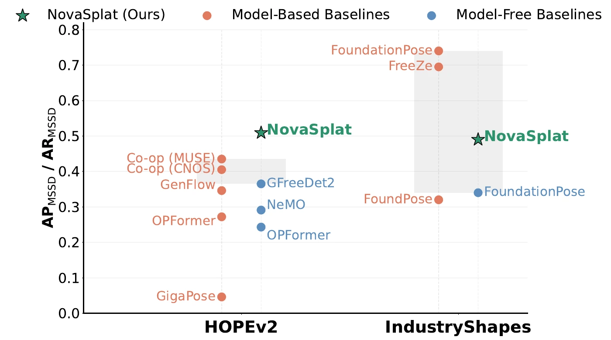

Given a short video of a novel object captured during onboarding, NovaSplat estimates its 6D pose in new scenes **without a 3D model**.

## 📢 News
- NovaSplat is accepted to WACV 2027.
- 2026-10-27: NovaSplat ranks #1 in overall AP on the [BOP HOPEv2 leaderboard](https://bop.felk.cvut.cz/leaderboards/modelfree-pose-detection-unseen-bop24/hopev2/) (model-free 6D detection).

## 💡 Overview

Model-free pose estimation of novel objects, without CAD models, is still an open problem, and model-free methods have long trailed model-based ones. NovaSplat trains a 3D Gaussian Splatting (3DGS) model from a short smartphone video of the object. The model serves as a template source for detection and coarse pose estimation, and as a differentiable backbone for pose refinement.

- **0.529 AP** on the HOPEv2 test set, with a **39.5%** relative gain in AP<sub>MSSD</sub> over GFreeDet2.
- **NovaSplat-Lite** is **3.1x faster** for only 0.001 AP loss on HOPEv2.
- On IndustryShapes it outperforms the evaluated model-free methods and narrows the gap to model-based ones.

## 🧭 Method

<a href="assets/pipeline.webp">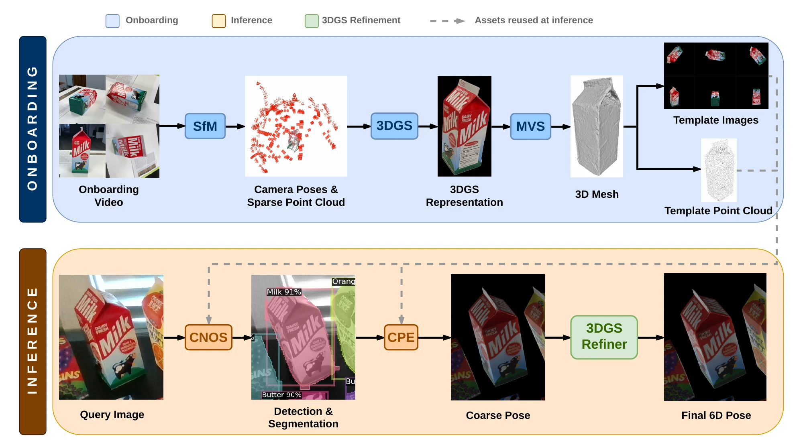</a>

NovaSplat has two stages:

1. **Onboarding.** SfM, Multi-View Stereo (MVS), and 3DGS training on the video frames and object masks produce a 3D mesh and an optimized 3DGS representation. Template images and a template point cloud are rendered from them.
2. **Inference.**
   - **Coarse pose estimation.** Visual (DINOv3) and geometric (GeDi) descriptors are matched to obtain 3D-3D correspondences, which RANSAC turns into a coarse pose.
   - **3DGS-based pose refinement.** Starting from the coarse estimate, the refiner jointly minimizes photometric and geometric losses through the differentiable 3DGS representation, using a continuous rotation parametrization.

## 📋 Results

### HOPEv2 (BOP detection protocol)

NovaSplat has the highest overall AP and AP<sub>MSSD</sub> among the evaluated methods.

| Method                | CAD | AP ↑      | AP<sub>MSSD</sub> ↑ | AP<sub>MSPD</sub> ↑ |
|-----------------------|-----|-----------|---------------------|---------------------|
| GigaPose              | Yes | 0.167     | 0.046               | 0.288               |
| OPFormer\*            | Yes | 0.351     | 0.272               | 0.431               |
| GenFlow               | Yes | 0.411     | 0.346               | 0.475               |
| Co-op (CNOS)          | Yes | 0.477     | 0.405               | 0.549               |
| Co-op (MUSE)          | Yes | 0.514     | 0.435               | **0.593**           |
| NeMO                  | No  | 0.302     | 0.291               | 0.312               |
| OPFormer\*            | No  | 0.335     | 0.243               | 0.427               |
| GFreeDet2             | No  | 0.452     | 0.365               | 0.538               |
| **NovaSplat**         | No  | **0.529** | **0.509**           | 0.548               |
| **NovaSplat-Lite**    | No  | 0.528     | **0.509**           | 0.547               |

\* OPFormer results are taken from the BOP leaderboard.

### IndustryShapes (BOP localization protocol)

NovaSplat leads the evaluated model-free methods on both splits. Model-based methods keep an advantage on these textureless, specular industrial parts.

| Method          | CAD | Classic AR ↑ | Extended AR ↑ |
|-----------------|-----|--------------|---------------|
| FreeZe          | Yes | 0.64         | 0.61          |
| FoundPose       | Yes | 0.30         | 0.28          |
| FoundationPose  | Yes | **0.67**     | **0.69**      |
| OnePose         | No  | 0.07         | 0.02          |
| OnePose++       | No  | 0.14         | 0.20          |
| FoundationPose  | No  | 0.25         | 0.33          |
| **NovaSplat**   | No  | **0.36**     | **0.40**      |

### Effect of pose refinement

Joint photometric and geometric alignment through the differentiable 3DGS representation refines the coarse pose. Bounding cuboids show the predicted poses.

| Coarse pose (before refinement) | Refined pose (NovaSplat) |
|:-------------------------------:|:------------------------:|
| 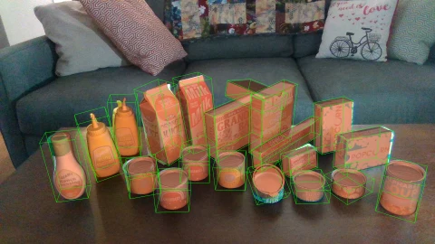 | 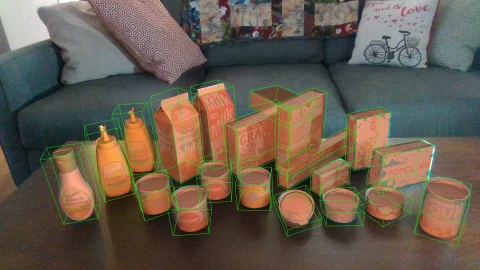 |

### Qualitative comparison on HOPEv2

NovaSplat estimates poses robustly in cluttered scenes with heavy occlusions and outperforms competing model-free methods. Images are HOPEv2 frames (BOP-H3, CC BY-SA 4.0) with predicted poses overlaid; see [assets/LICENSE.md](assets/LICENSE.md).

| Original | NovaSplat (Ours) | GFreeDet2 | OPFormer | NeMO |
|:--------:|:----------------:|:---------:|:--------:|:----:|
| 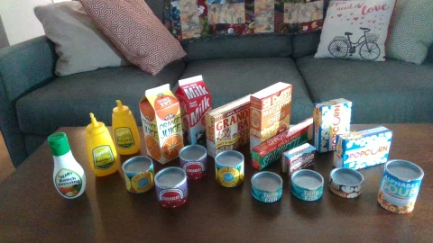 |  | 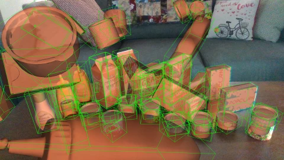 | 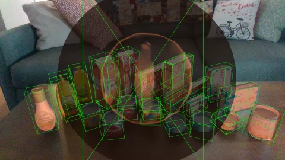 | 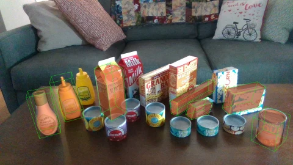 |
| 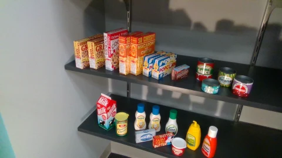 | 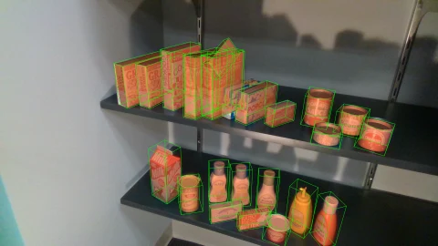 | 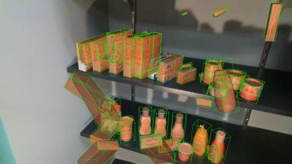 | 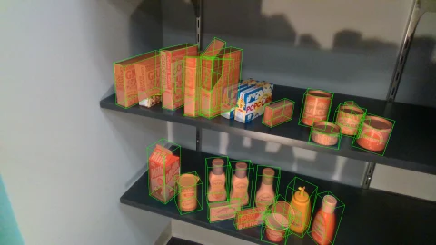 | 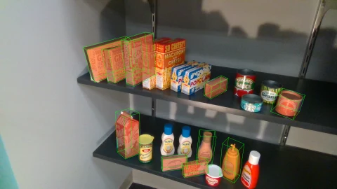 |
| 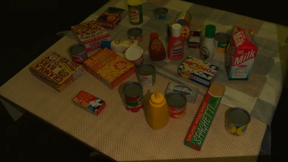 | 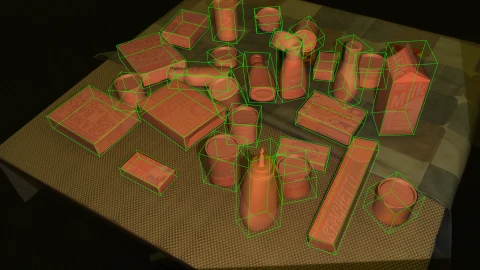 | 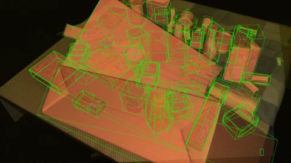 | 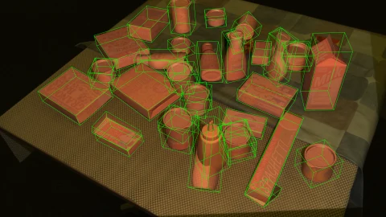 | 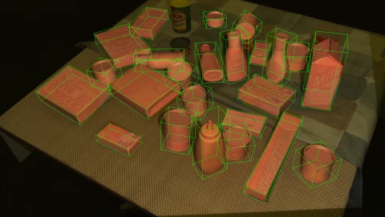 |

## 🔧 Installation

An NVIDIA GPU with CUDA is required. The Docker image below uses CUDA 12.8.

### 1. Clone and populate the submodules

The third-party components live in `thirdparty/` as git submodules. Clone with submodules, or populate them after cloning:

```bash
git clone --recurse-submodules https://github.com/POSE-Lab/novasplat.git
cd novasplat
# if you cloned without --recurse-submodules:
git submodule update --init --recursive
```

### 2. Create a virtual environment

Create and activate a virtual environment, for example with virtualenvwrapper:

```bash
mkvirtualenv novasplat
workon novasplat
```

Any other way of creating a virtual environment works too, but please use one.

### 3. Install the prerequisites

```bash
./install.sh
```

### Docker (Ubuntu 24.04 + CUDA)

Alternatively, you can build a CUDA-enabled container image that runs the same installation flow as `install.sh`.

Requirements on the host:
- Docker
- NVIDIA Container Toolkit (for `--gpus all`)
- NVIDIA driver compatible with CUDA 12.8 runtime (driver >= 570)

The repository includes a `Makefile` for Docker workflows. Build the image from the repository root:

```bash
make build
```

Run an interactive shell with GPU access:

```bash
make shell
```

Default values used by the `Makefile`:
- `IMAGE_NAME=novasplat`
- `IMAGE_TAG=cuda128`
- `DATA_DIR=$HOME/data` (mounted at `/root/data`)
- `OUTPUT_DIR=$PWD/output` (mounted at `/workspace/novasplat/output`)
- `IPC_MODE=host`
- `SHM_SIZE=8g`

Override variables as needed, for example:

```bash
make build IMAGE_TAG=cuda128
make shell DATA_DIR=$HOME/data OUTPUT_DIR=$PWD/output SHM_SIZE=16g
```

If you need a different OpenMVS target architecture, edit `OPENMVS_CUDA_ARCHITECTURES` in the `Dockerfile` (default: `80`), or rerun `install.sh` in the container with:

```bash
OPENMVS_CUDA_ARCHITECTURES=89 ./install.sh
```

## 📦 Data and Model Weights

### Data

To download the necessary data from the BOP corpus of datasets, use the following commands:

```bash
# BOP Classic
python download_bop_classic.py -d ~/data
# BOP-H3
python download_bop_h3.py -d ~/data
```

This downloads all onboarding sequences from the BOP-H3 corpus. To download only a subset, use the corresponding command-line arguments:

```bash
python download_bop_h3.py -d ~/data --datasets hope -t static
```

### Model weights

Model weights are not included in this repository. Download them from the upstream sources and accept their licenses (see [License](#-license)). The detection stage reads the following files from `thirdparty/cnos25/models/`:

| File | Used for |
|------|----------|
| `dinov3_vitl16_pretrain_lvd1689m-8aa4cbdd.pth` | DINOv3 features ([facebookresearch/dinov3](https://github.com/facebookresearch/dinov3); gated, requires accepting Meta's license) |
| `yoloe-11l-seg.pt` | YOLOE object proposals ([Ultralytics](https://docs.ultralytics.com/models/yoloe/)) |

The paths can be changed in `thirdparty/cnos25/configs/local.yaml`.

`mobileclip_blt.ts` (the MobileCLIP text encoder used by YOLOE) needs no manual download: Ultralytics fetches it automatically on first use into the directory the code runs from (`thirdparty/cnos25/`). It is licensed by Apple for research purposes only (see [License](#-license)).

The SAM 3 utility reads a Hugging Face token from `HUGGINGFACE_HUB_TOKEN` or `HF_TOKEN` (see [Utilities](#-utilities)).

## 🏃 Usage

The pipeline has three steps: onboarding, (optional) template feature extraction, and inference.

### Onboarding

#### Train the splat for a single object

```bash
./run_onboarding.sh <input_dir> <output_dir> <object_id> <icosphere_level>
```

For example:

```bash
./run_onboarding.sh ~/data/bop_h3/hopev2/onboarding_static output obj_000001 2
```

#### Run the onboarding on a whole dataset

Change the paths in the following file to point to the corresponding directories:

```
thirdparty/cnos25/configs/local.yaml
```

Then use the following command:

```bash
./run_onboarding.sh <input_dir> <output_dir> <dataset_name> <icosphere_level>
```

For example:

```bash
./run_onboarding.sh ~/data/bop_h3/hopev2/onboarding_static output hopev2 2
```

Currently it only works with `hopev2` and `handal`.

### Extract features for pre-rendered templates

If you already have templates from a separate onboarding (each `obj_*` directory containing `rgb/`, `mask_visib/`, `depth/*.npz`, `rendered_camera_params.npz` and `model.ply`) but no `features/`, extract just the DINOv3 + GeDi + fused features without re-running the full onboarding:

```bash
./run_template_features.sh -i <templates_dir>
```

For example:

```bash
./run_template_features.sh -i ~/data/bop_h3/hopev2/templates
```

This writes `features/{dinov3,gedi,fused}.pt` in place under each `obj_*` directory (pass `-o <dir>` to write elsewhere, `--object obj_000001` for a single object, `--overwrite` to recompute). Inference then picks the templates up automatically. Note that this does not produce the CNOS25 template descriptor cache (`templates/descriptors/`) used by the detection stage.

### Inference

Run the inference on a whole dataset:

```bash
# Inference on validation set
./run_inference.sh ~/data/bop_h3 hopev2 output val

# Inference on test set
./run_inference.sh ~/data/bop_h3 hopev2 output test
```

### Visualization

To visualize the 2D detection results, run the following from `thirdparty/cnos25`:

```bash
mkdir viz_hopev2_2_val
python -m src.scripts.visualize_detectron2 dataset_name=hopev2 split=val input_file=outputs/{...}/nms-{...}.json output_dir=viz_hopev2_2_val
```

To visualize the depth maps rendered from the 3D mesh model, run the following script (and adjust the paths accordingly):

```bash
python -m novasplat.utils.visualize_depth_maps \
  --depth_dir ~/data/bop_h3/hopev2/templates/obj_000001/depth \
  --cam_params ~/data/bop_h3/hopev2/templates/obj_000001/rendered_camera_params.npz \
  --output_dir ~/data/bop_h3/hopev2/templates/obj_000001/plys
```

## 🧰 Utilities

### DINOv3 features

To extract DINOv3 features from a directory of images, use the following script:

```bash
python -m novasplat.features.dense_features \
  --dinov3_model_path thirdparty/dinov3 \
  --image_dir <images_path> \
  --output_path <path to dinov3.pt> \
  [--mask_dir <masks_path>]
```

### Improve segmentation masks with SAM 3

You can use SAM 3 to improve the segmentation masks that are provided:

```bash
export HUGGINGFACE_HUB_TOKEN="hf_..."   # only in current shell
python -m novasplat.sam -i ... -o ... -t "prompt"
```

For example:

```bash
export HUGGINGFACE_HUB_TOKEN="hf_..."   # only in current shell
python -m novasplat.sam -i ~/data/bop_h3/hopev2/onboarding_static/obj_000014_up/mask_visib -o output/masks/obj_000014_up -t Milk
```

## 📜 License

The NovaSplat source code is released under the [MIT License](LICENSE).

This license covers only code written by the NovaSplat authors. Third-party components keep their own licenses; see [THIRD_PARTY_NOTICES.md](THIRD_PARTY_NOTICES.md) for the full list. In particular:

- SAM 3 and DINOv3 (code and model weights) are under Meta's custom licenses. Download the weights yourself and accept their terms.
- `ultralytics`, imported by the vendored `thirdparty/cnos25` code, is AGPL-3.0. Using or deploying that code path carries AGPL-3.0 obligations.
- `install.sh` and the `Dockerfile` build OpenMVS (AGPL-3.0) and VCGlib (GPL-3.0) from source on your machine.
- The MobileCLIP text encoder (`mobileclip_blt.ts`), which Ultralytics downloads for YOLOE text prompts, is released by Apple under the [Apple ML Research Model terms](https://github.com/apple/ml-mobileclip/blob/main/LICENSE_MODELS): research purposes only, no commercial use.
- The images in [`assets/`](assets) are licensed under [CC BY-SA 4.0](assets/LICENSE.md), not MIT. The qualitative images contain frames from the HOPEv2 dataset (BOP-H3, test images by Anas Gouda, CC BY-SA 4.0) overlaid with predicted poses.

## 🎓 Citation

NovaSplat has been accepted at the IEEE/CVF Winter Conference on Applications of Computer Vision (WACV) 2027 ([arXiv:2610.13309](https://arxiv.org/abs/2610.13309)). If you use this code in your research, please cite the paper. The BibTeX entry is below and also in [CITATION.bib](CITATION.bib).

```bibtex
@inproceedings{floros2027novasplat,
  title         = {NovaSplat: Model-Free 6D Object Pose Estimation via 3D Gaussian Splatting Onboarding and Refinement},
  author        = {Floros, Georgios and Sartinas, Evangelos and Vaggelis, Orestis and Pateraki, Maria},
  booktitle     = {Proceedings of the IEEE/CVF Winter Conference on Applications of Computer Vision (WACV)},
  year          = {2027},
  eprint        = {2610.13309},
  archivePrefix = {arXiv},
  primaryClass  = {cs.CV}
}
```
